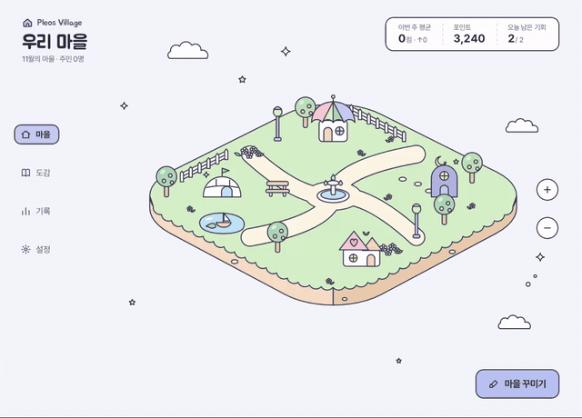
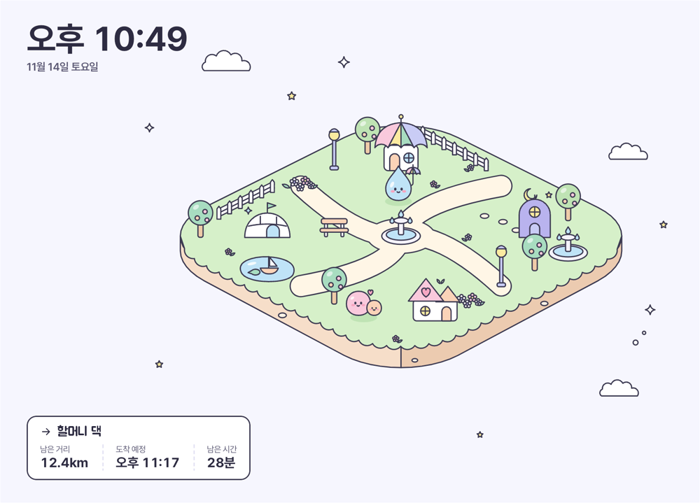
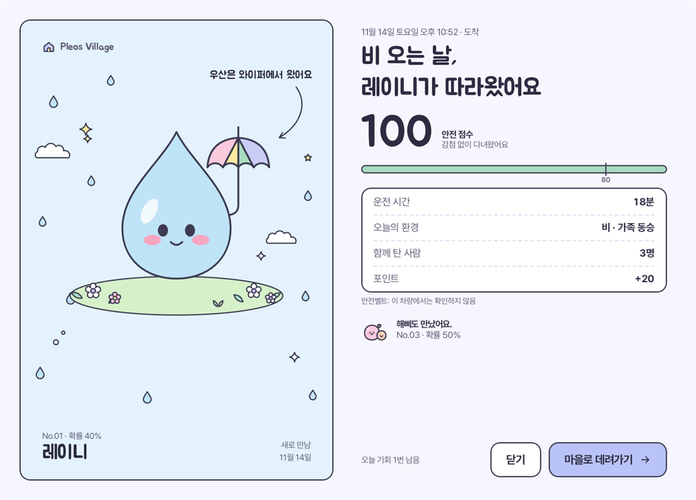
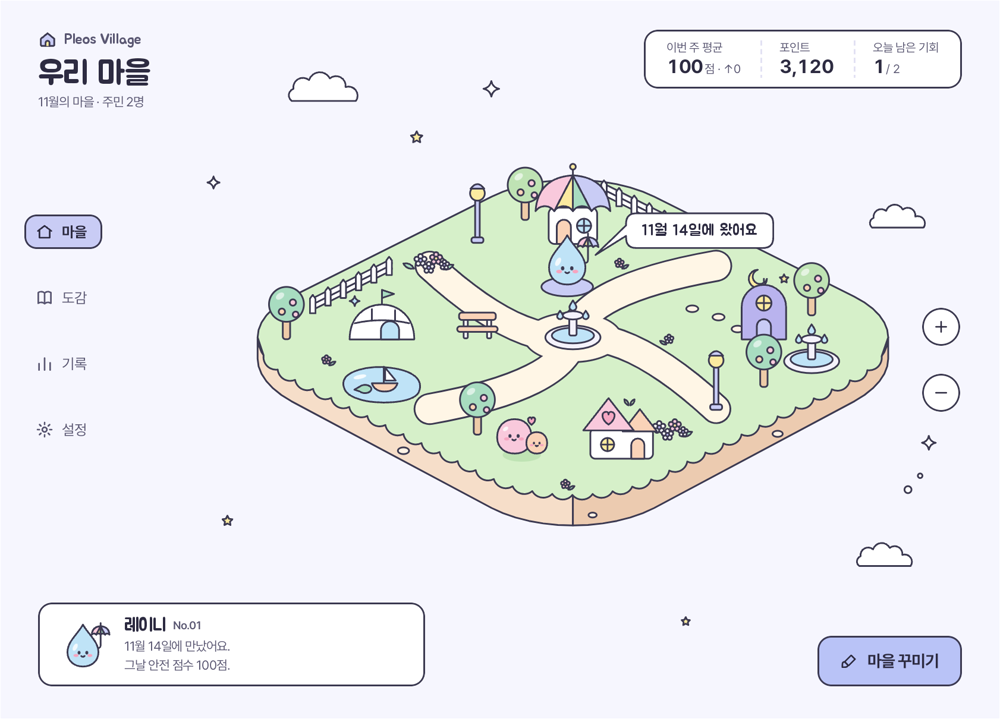
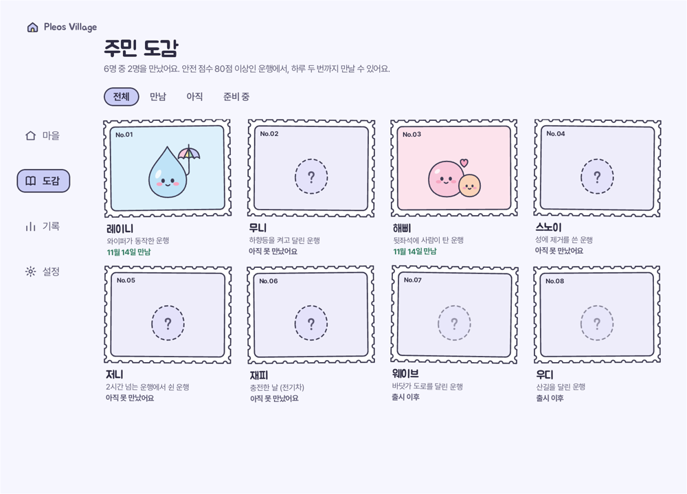
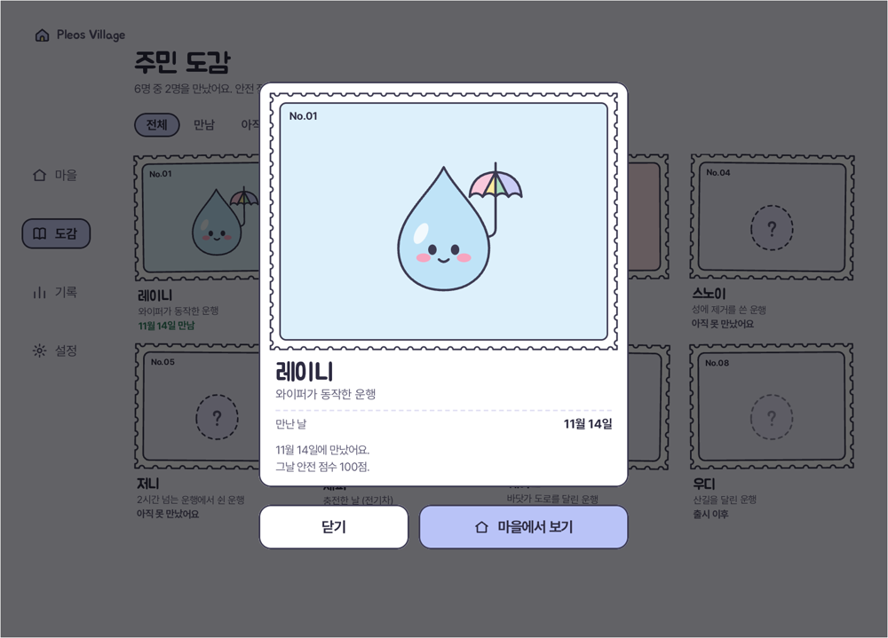
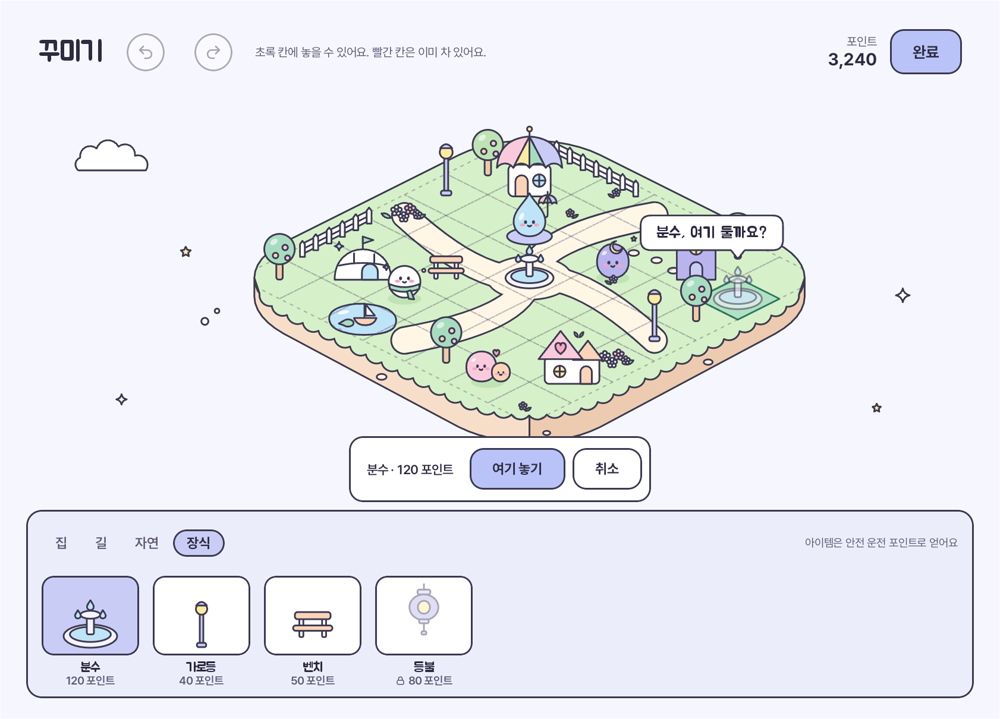
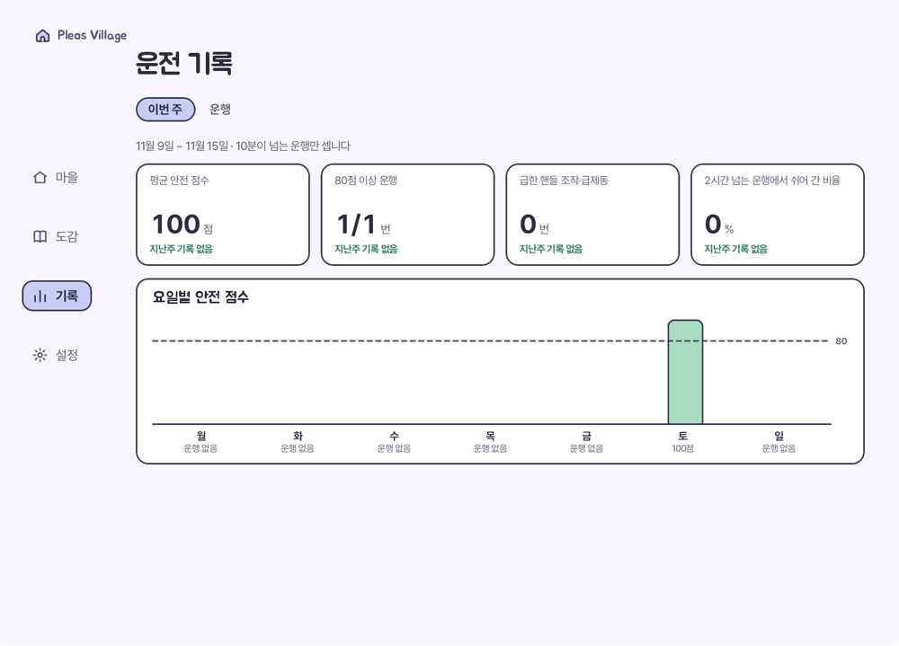
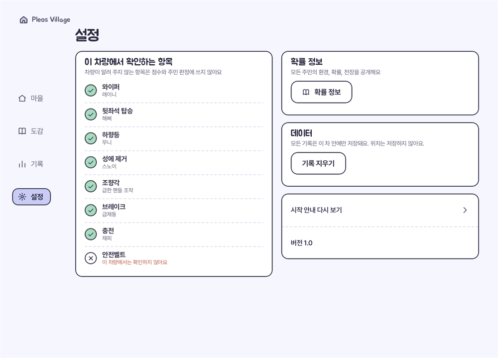
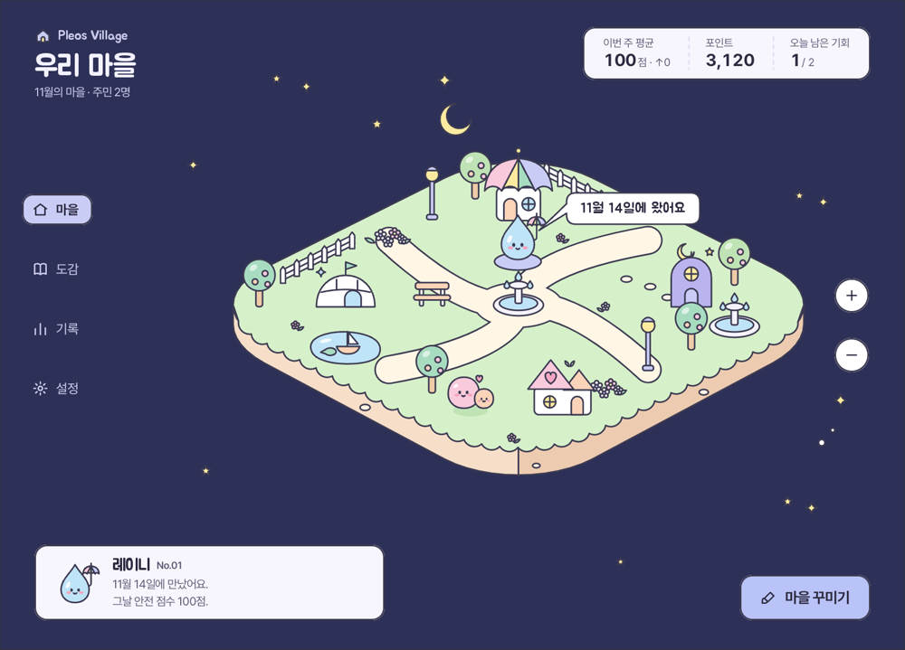

# Pleos Village

**운전이 그대로 우리 가족 마을이 되는 차량용 앱** — Pleos Connect(Android Automotive OS)용

운전하는 동안에는 화면 조작 없이 차량 데이터만 기록합니다. 정차(기어 P)하면 **도착 요약**에서 안전 점수를 보여 주고, 80점 이상이면 그날의 운전 환경(비, 밤, 가족 동승 등)에 맞는 **주민**을 만납니다. 만난 주민은 **마을**에 모입니다.

<p align="center">
  
</p>
<p align="center"><sub>시연 영상 4.5배속 · 원본(2분): <a href="docs/media/demo.mp4">docs/media/demo.mp4</a></sub></p>

**APK 다운로드:** [Releases v1.0.0](https://github.com/yangleejung/Pleos-Village/releases/tag/v1.0.0) — `yangleejung_PleosVillage_release.apk`

---

## 이렇게 동작해요

| 1. 운전 중 | 2. 정차 | 3. 마을 |
|---|---|---|
| 조작할 수 없는 유휴 화면(마을·시계·길 안내)만 보입니다. 앱은 와이퍼, 하향등, 좌석 탑승, 성에 제거, 조향각, 브레이크를 기록합니다. | 기어 P → 도착 요약. 안전 점수와 감점 내역, 오늘의 환경, 만난 주민과 못 만난 주민을 보여 줍니다. | 만난 주민이 마을에서 걸어 다닙니다. 안전 운전 포인트로 마을을 꾸밉니다. |
|  |  |  |

## 화면

| 도감 | 주민 카드 | 꾸미기 |
|---|---|---|
|  |  |  |
| **운전 기록** | **설정** | **밤 모드** |
|  |  |  |

- **도착 요약**: 점수와 80점 막대, 운전 시간·환경·탑승 인원·포인트, 감점 내역, 못 만난 주민. 80점 미만·짧은 운행·하루 한도 등 상태별 안내
- **마을**: 비스듬히 내려다보는 섬, 주민을 누르면 말풍선과 카드, 끌어서 이동·확대
- **꾸미기**: 끌어 놓기 또는 누르고 놓기, 놓을 칸 미리보기, 옮기기·돌리기·보관함, 되돌리기
- **도감**: 우표 카드, 누르면 큰 카드
- **기록**: 이번 주 평균 점수·80점 이상 비율·급한 조작 횟수, 요일별 점수, 운행 목록
- **설정**: 이 차량에서 확인하는 항목, 확률 정보(모든 주민의 확률·천장 공개)
- **유휴 화면**: 10초 동안 조작이 없거나 주행 중이면 마을만 남기고 시각과 길 안내(남은 거리·도착 예정·남은 시간)를 표시
- 넓은 배치(가로)와 좁은 배치(세로), 낮·밤 모드를 모두 지원합니다.

## 주민

| 주민 | 만나는 환경 |
|---|---|
| 레이니 | 와이퍼가 동작한 운행 (비) |
| 해삐 | 뒷좌석에 사람이 탄 운행 (가족) |
| 무니 | 하향등을 켜고 달린 운행 (밤) |
| 스노이 | 성에 제거를 쓴 운행 (겨울) |
| 저니 | 2시간 넘는 운행에서 쉰 운행 (장거리) |
| 재피 | 충전한 날 (전기차) |
| 웨이브 · 우디 | 바다 · 산 (출시 이후) |

## 규칙

- **안전 점수**: 운행마다 100점에서 시작해 급한 핸들 조작(1초 안에 90° 넘게)과 급제동을 각각 −10점
- **판정**: 10분 이상 주행하고 80점 이상인 운행만, 하루 2번까지. 주민마다 운행당 한 번
- **만남**: 환경을 채운 판정에서 정해진 확률로 만나고, 여러 번 못 만나면 반드시 만나도록 보정합니다. 자세한 값은 앱의 설정 > 확률 정보에 있습니다.
- **포인트**: 90점 이상 +20, 80점대 +10. 꾸미기 아이템에만 쓰고 주민은 포인트나 결제로 얻을 수 없습니다.
- **개인정보**: 모든 기록은 차량 안에만 저장하고 위치는 수집하지 않습니다.

## 기술

- Kotlin, Jetpack Compose (모든 그림은 Canvas로 직접 그림)
- Pleos Vehicle SDK 2.3.2 (조회 전용), Pleos NaviHelper SDK 3.0.5 (길 안내 조회)
- `CarUxRestrictionsManager`로 주행 규제, `CarPropertyManager`로 기어
- 판정 로직은 Android 의존성이 없는 순수 Kotlin(`domain/`)이고 JVM 단위 테스트로 검증합니다.

```
automotive/src/main/java/com/grad/pleosvillage/
├── domain/     판정 엔진 (운행·휴식·환경·안전 점수·확률·천장·포인트)
├── data/       저장소 (JSON), 화면 모델 변환, 꾸미기 상태
├── vehicle/    차량 데이터 (Vehicle SDK, CarPropertyManager), 내비 데이터
├── service/    RecordingService (화면이 없어도 기록하는 Foreground Service)
└── ui/         화면 (arrival, village, dex, records, settings, decorate, onboarding, debug), 디자인 시스템, 그림
```

## 빌드와 실행

**테스트 환경**
- Pleos Connect Emulator v2.1.0 (Android 14, API 34)
- 화면 규격: 1600×900 에뮬레이터 기준. 앱 창은 Driving View와 하단 상태바를 뺀 영역입니다.
  - 넓은 배치(앱 창 1개, 가로형): 1152×748dp
  - 좁은 배치(앱 창 2개 중 하나, 세로형): 571×748dp
  - 앱 창 너비가 840dp 이상이면 넓은 배치, 미만이면 좁은 배치로 자동 전환됩니다.
- 필요한 것: Android Studio(JDK 17)

**APK로 바로 실행**
```bash
adb install yangleejung_PleosVillage_release.apk
adb shell am start -n com.grad.pleosvillage/.MainActivity
```

**소스에서 빌드**
```bash
./gradlew :automotive:assembleDebug        # 빌드
./gradlew :automotive:installDebug         # 에뮬레이터에 설치
./gradlew :automotive:testDebugUnitTest    # 단위 테스트 (에뮬레이터 필요 없음)
adb shell am start -n com.grad.pleosvillage/.MainActivity
```

### 에뮬레이터에서 시험하기

Virtual Console(`adb forward tcp:8088 tcp:8088` 후 브라우저에서 `http://127.0.0.1:8088/`)로 기어, 와이퍼, 좌석 탑승, 조향각, 브레이크를 바꿉니다. 디버그 빌드에서는 설정 > 버전을 7번 누르면 디버그 메뉴(시연 데이터, 시간 배율 60×, 초기화 등)가 열립니다.

```bash
tools/scenarios.sh        # 시연 시나리오 A~D를 자동 실행하고 통과/실패를 판정 (Git Bash)
tools/demo_video.sh       # 시연 영상을 자동으로 녹화해 build/demo/에 저장 (ffmpeg 필요)
```

| 시나리오 | 내용 |
|---|---|
| A | 와이퍼 + 뒷좌석 탑승 → 100점, 레이니·해삐 만남 |
| B | 급한 핸들 조작 2번 + 급제동 1번 → 70점, 주민 없음 |
| C | 2시간 넘게 운전하고 15분 휴식 → 저니 만남 |
| D | 하루 판정 2번을 채운 뒤 → 판정하지 않음 |

## 문서

- [docs/SPEC.md](docs/SPEC.md) — 기능 규칙 (운행·휴식·안전 점수·판정·시연 시나리오)
- [docs/UI_SPEC.md](docs/UI_SPEC.md) — 화면 설계
- [docs/design/REFERENCES.md](docs/design/REFERENCES.md) — 디자인 시스템 (v4 파스텔 선화)

## 라이선스

글꼴: [Jua](docs/licenses/Jua-OFL.txt), [Pretendard](docs/licenses/Pretendard-OFL.txt) — SIL Open Font License 1.1
